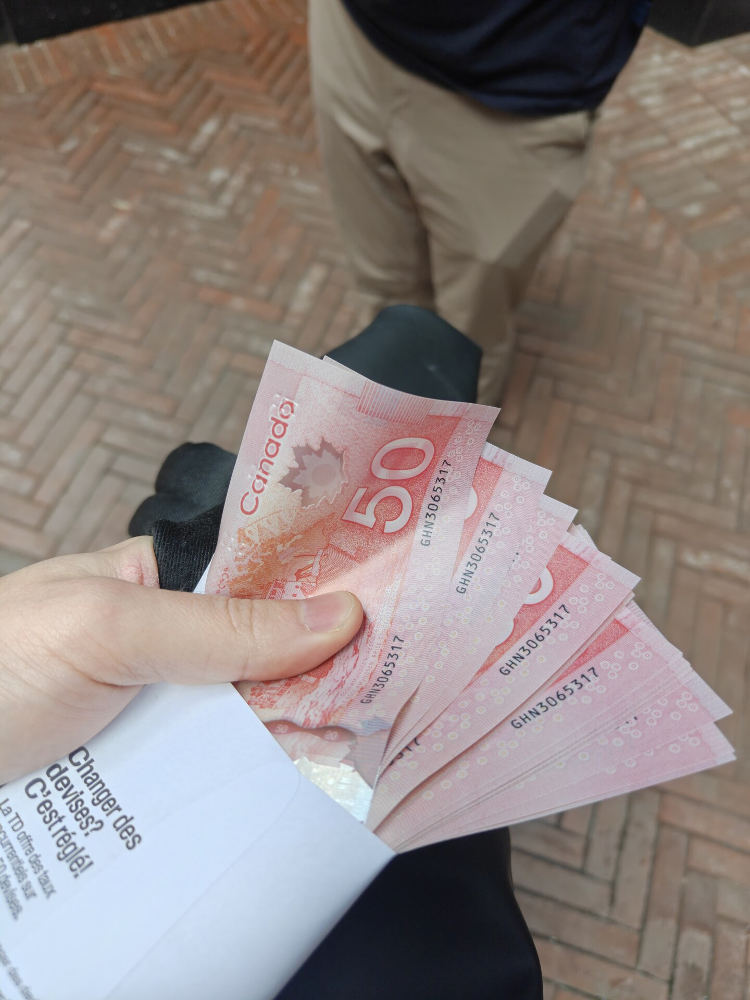


A note mainly for SEO purposes: If you bought a Pixel 11 Pro Fold with IMEI `353800652607702`, SN `65091FDDJ000QE`, you have a stolen phone. It was stolen from me. If you'd like to return it, I am easily reachable at [kn100@kn100.me](mailto:kn100@kn100.me). If not, oh well. Life goes on.


I had been using a Pixel 9 Pro Fold for around two years, and after the second one failed the same way as the first, I contacted Google to do the warranty merry-go-round, and they very kindly offered to upgrade me to the Pixel 11 Pro Fold. It was a huge upgrade, but unfortunately I'd already decided I wanted off the folding train. As much as I love and will miss the larger screen, I value a phone lasting longer than 11 months more than I value having a larger screen, so I went and bought something else, and resolved to sell the Pixel 11 Pro Fold. 

I then met with Some Guy from Facebook Marketplace in a very public place in Downtown Toronto (with cameras) to sell the phone. He seemed nice, not really giving me any vibe that anything might be off. We exchanged cash. I counted it, handed him the phone, and on my merry way I went.

It was only a few hours later, when I took a closer look at the cash, that I noticed the serial number for every single bank note was exactly the same. 

I reported it to the police, of course. I am not particularly hopeful that anything comes of this, since trying to track down a stolen phone, especially one that wasn't even activated, is not exactly trivial, but perhaps the fake currency angle will trigger some more serious investigation.

I got duped because handling a large amount of cash in public is always slightly scary, which makes it hard to pay attention to the small details of bank notes. Nobody wants to flash large amounts of cash. Next time I'm demanding an e-transfer.

Consider this a warning. Pay very close attention to cash you are handed for Facebook Marketplace-type sales. It turns out fake currency is more common than I thought.

