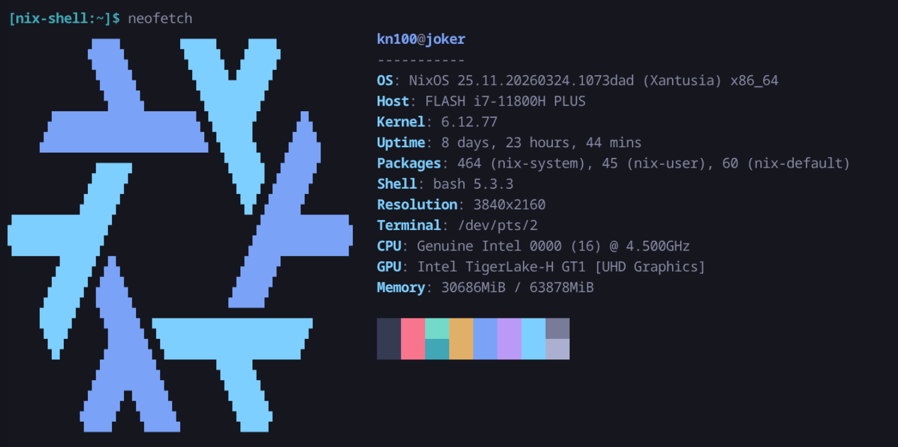

I've had a fair bit of fun with Proxmox for a couple of years, but recently I got a bit bored and decided to give NixOS a go. What I was looking for was a simpler way to manage my stack of services, as well as a more declarative way of doing so. 



## How we got here

I tried various iterations of setups using Proxmox. My first iteration involved running many small LXC containers each hosting a single service. This approach worked okay, but I kept running into really irritating quirks of doing things this way. For example, the uid/gid mapping within LXC containers is a constant source of confusion and pain, as well as hardware passthrough being beyond me with regards to getting it all set up. 

My second iteration involved a hybrid approach, where I ran several LXC containers for simpler services, and a full fat VM for more complex setup. This approach worked okay too, except for some really dumb compromises I was forced to make. The dumbest was that there is no real way to "share" hard drives between the host and the VMs/LXC containers. While you can passthrough entire hard drives to a VM, that didn't work for me as I also wanted those drives to be accessible to other things. Instead, what I ended up doing is hosting a LXC container whose sole purpose was to expose the drives via a Samba share, which would then be mounted by the other containers and VMs. Suffice to say this sucked.

The third iteration was a single VM, hosting all my services. Essentially, it was just a docker compose setup running on a Linux VM running inside Proxmox. This was the longest lasting of my setups, but it's pretty stupid to have this entire hypervisor sitting around doing nothing but hosting a simple VM, whose job it was to itself host containers. It works, but why?

Which leads me to where I am now. The setup I wanted to give a proper go was NixOS. I've attempted to use NixOS as a desktop operating system in the past, but found it to be just too much of a pain in the butt for a machine I am actively using. I really loved the concept, and have been using the Nix package manager in various spots here and there ever since, but I definitely wasn't ready to give up the flexibility of a more traditional linux install on my main machine. 

## What I wanted

A brief aside on what my homelab "is" to me. I treat it as a constantly running place for services I use almost daily. Nothing is exposed to the public internet. Some things I host are very important to me, other things I just do for fun. I often deploy personal projects I am working on to it, or perhaps try out some interesting project I found somewhere. 

All this to say that I value flexibility, as well as some degree of environment stability. I also do not really want to be pinned in an ecosystem, or be forced to set things up in any particular way. 

Given some things I host are particularly important to me, it is important to me that I am able to easily stand up the whole thing again if necessary. I don't mind spending a weekend or something getting it running, but it is important to me that I can do this without having to rely on my prodigiously bad memory.

So, NixOS seemed perfect. Deterministically setting up my system, in a manner that can be mostly/fully reproducible, with no real "opinions", sounded great. 

I wanted to move away from Docker, virtual machines, and containers in general. There are plenty of very good options for isolating processes on a Linux install these days that are conceptually much simpler than containers. When you're not fighting through layers of abstraction, a lot of the pain points of running services in a homelab environment just disappear.

I wanted my services that required access to my hard drives to have direct access to them. No more mounting a samba share. I wanted services that needed GPU to just be able to... get to the GPU.

I wanted to be able to keep (ab)using Tailscale the way I have been for years. I have a fairly elaborate tailnet setup that I will describe later on, but it was important to me that I keep this around.

## The beauty of NixOS


I no longer have to run services in containers unless I want to. I will share a few examples of things I have set up to try to get why I am so happy with my setup with you.

### Jellyfin

I used to run Jellyfin in a docker container. If you're unfamiliar with Jellyfin, it's a lot like Plex, but is open source. Now, it just runs bare metal. Since this is NixOS, I can share my configuration for it with you, and you can have the exact same setup! In particular, I had to do some awkward driver shenanigans in order to get jellyfin to successfully use the GPU how I wanted it to, but now it works absolutely fantastic. Now Jellyfin can tone-map HDR content to SDR when required, using the GPU. In addition, now it has direct access to my hard drives, performance is absolutely stellar.

```nix
{ config, pkgs, ... }:

{
  services.jellyfin = {
    enable = true;
    openFirewall = true;
  };

  networking.firewall.allowedTCPPorts = [
    8096
    8920
  ];

  systemd.services.jellyfin = {
    # This environment block ensures FFmpeg knows exactly which driver to use
    # and where to find the OpenCL/VPL runtimes for HDR tone mapping.
    environment = {
      LIBVA_DRIVER_NAME = "iHD";
      # Helps FFmpeg find the Intel Compute Runtime for HDR tone mapping
      OCL_ICD_VENDORS = "${pkgs.intel-compute-runtime}/etc/OpenCL/vendors/intel.icd";
    };

    serviceConfig = {
      ProtectSystem = "full";
      PrivateDevices = false;
      DeviceAllow = [
        "/dev/dri/renderD128"
        "/dev/dri/card0"
      ];

      BindPaths = [
        "/etc/OpenCL/vendors"
      ];
      BindReadOnlyPaths = [
        "/mnt/linux-isos"
      ];
    };
  };

  # This creates the physical directory and the link that FFmpeg looks for
  environment.etc."OpenCL/vendors/intel.icd".source =
    "${pkgs.intel-compute-runtime}/etc/OpenCL/vendors/intel.icd";

  hardware.graphics = {
    enable = true;
    extraPackages = with pkgs; [
      intel-media-driver # Primary iHD driver for 11th Gen
      intel-compute-runtime # Required for HDR -> SDR Tone Mapping
      vpl-gpu-rt # Video Processing Library (replaces Media SDK for 11th Gen+)
      intel-gpu-tools # Useful for running 'intel_gpu_top' to verify usage
    ];
  };

  users.users.jellyfin = {
    extraGroups = [
      "video"
      "render"
      "some-data-access-group"
    ];
  };
}
```

### Home Assistant

I also ran HASS as a docker container. Now, I have a simple, declarative configuration for it.

```nix
{
  config,
  pkgs,
  lib,
  ...
}:

{
  services.home-assistant = {
    enable = true;
    extraComponents = [
      "default_config"
      "met"
      "esphome"
      "mqtt"
      "zha"
      "wled"
      "cast"
      "androidtv_remote"
      "radio_browser"
      "logbook"
      "recorder"
      "history"
      "energy"
      "usage_prediction"
      "jellyfin"
    ];
    config = {
      default_config = { };
      logbook = { };
      http = {
        trusted_proxies = [
          "127.0.0.1"
          "::1"
          "100.64.0.0/10"
        ];
        use_x_forwarded_for = true;
      };

      # Import our JSON-converted configurations
      automation = lib.importJSON ./home-assistant/automations.json;
      scene = lib.importJSON ./home-assistant/scenes.json;
      script = lib.importJSON ./home-assistant/scripts.json;
    };
  };

  networking.firewall.allowedTCPPorts = [ 8123 ];
}
```

You'll notice in particular the imported JSON files. I of course prefer writing YAML instead of JSON (They both suck, but YAML is marginally less painful to write in my opinion), but there as far as I know is no way to import YAML using Nix config like this, so I wrote a stupid script that converts my YAML to JSON so it can be imported, and it runs before every rebuild.

```bash
BASE_DIR="modules/services/home-assistant"

for file in automations scenes scripts; do
  if [ -f "$BASE_DIR/$file.yaml" ]; then
    echo "Syncing $file.yaml -> $file.json..."
    yj < "$BASE_DIR/$file.yaml" > "$BASE_DIR/$file.json"
  fi
done

echo "Done!"
```

### Minecraft Server

Did you know you can declaratively define a Minecraft Server? I certainly did not, but I am so happy that I can.

```nix
{
  config,
  pkgs,
  inputs,
  ...
}:

{
  services.minecraft-servers = {
    enable = true;
    eula = true;
    openFirewall = true;

    servers.main = {
      enable = true;
      package = pkgs.paperServers.paper;

      jvmOpts = "-Xms8192M -Xmx8192M -javaagent:plugins/nova.jar";

      serverProperties = {
        server-port = 25565;
        difficulty = 3;
        gamemode = 0;
        max-players = 4;
        motd = "Mine carefully — this server runs on vibes and ZFS snapshots.";
        white-list = false;
        enforce-whitelist = false;
        allow-cheats = true;
        online-mode = true;
      };

      operators = {
        "some-mc-user" = "ffffffffffffffffffffffffffffffff";
      };

      symlinks = {
        "plugins/VeinTreeBreaker.jar" = pkgs.fetchurl {
          url = "https://hangarcdn.papermc.io/plugins/ayberkconff/VeinTreeBreaker/versions/1.0-SNAPSHOT-1.21.11/PAPER/VeinTreeBreaker-1.0-SNAPSHOT-1.21.11.jar";
          hash = "sha256-O7aj2rOoVdnZq3cjV6pFtjXN6k7F9IQtEOeK6grywLQ=";
        };
        "plugins/Machines.jar" = pkgs.fetchurl {
          url = "https://github.com/xenondevs/Nova-Addons/releases/download/56/Machines-0.8.0%2BNova-0.22.jar";
          hash = "sha256-yi3LWag+MpkoZnGAXNRu+UKqZRhe4pQXUUf7mE2SzQA=";
        };
        "plugins/Simple_Upgrades.jar" = pkgs.fetchurl {
          url = "https://github.com/xenondevs/Nova-Addons/releases/download/57/Simple_Upgrades-1.9.1%2BNova-0.22.jar";
          hash = "sha256-uELz/LbOFCS9BekITErDWrls/dVVTsu7ahlvEFLP5ms=";
        };
        "plugins/gravediggerx.jar" = pkgs.fetchurl {
          url = "https://hangarcdn.papermc.io/plugins/SyntaxDevTeam/GraveDiggerX/versions/1.0.5-HOTFIX-1/PAPER/GraveDiggerX-1.0.5-HOTFIX-1.jar";
          hash = "sha256-+7XDdCY5TsxVV1no4wwH7aKyNrrSuDuMOGSrjCIGAiQ=";
        };
        "plugins/nova.jar" = pkgs.fetchurl {
          # Apparently required for hammers and jetpacks
          url = "https://github.com/xenondevs/Nova/releases/download/0.22.2/Nova-0.22.2%2BMC-1.21.11.jar";
          hash = "sha256-izuryENBNfnA99/tTV0BHZdKakD/dJc0Ofls3IcE4yk=";
        };
        "plugins/hammers.jar" = pkgs.fetchurl {
          url = "https://github.com/xenondevs/Nova-Addons/releases/download/56/Vanilla_Hammers-1.10.0%2BNova-0.22.jar";
          hash = "sha256-qfUOaujNiA5HJOySj1zVrHDTM6zfDyfzCQl3UMpMxu8=";
        };
        "plugins/networks.jar" = pkgs.fetchurl {
          url = "https://hangarcdn.papermc.io/plugins/Kwantux/Networks/versions/3.1.6/PAPER/Networks-3.1.6.jar";
          hash = "sha256-Gf79dDbHkENQC4JnCY8Ho7moAdaNZZn4Z4ZvhDy4SUA=";
        };
        "plugins/jetpacks.jar" = pkgs.fetchurl {
          url = "https://github.com/xenondevs/Nova-Addons/releases/download/56/Jetpacks-0.5.0%2BNova-0.22.jar";
          hash = "sha256-/dcP0aEHty+AxJE1Osor2j4ARHRYbSkWQkMmVZf05oE=";
        };
        "plugins/logistics.jar" = pkgs.fetchurl {
          url = "https://github.com/xenondevs/Nova-Addons/releases/download/56/Logistics-0.6.0%2BNova-0.22.jar";
          hash = "sha256-62ZVOdroPtKxaZoLkk25KtGuYvTtyzGEGssRqzg7RpY=";
        };
        "plugins/chestsort.jar" = pkgs.fetchurl {
          url = "https://hangarcdn.papermc.io/plugins/UrAvgCode/chestsort/versions/0.2.0/PAPER/chestsort-plus-0.2.0.jar";
          hash = "sha256-eM5Lv86qpIQ5x0yDIDlpFFdvNRE23oo8j6S3l2+ukdo=";
        };
      };

      files."plugins/Nova/configs/config.yml" = {
        value = {
          resource_pack = {
            auto_upload = {
              enabled = true;
              service = "self_host";
              port = 38519;
              host = "{some-host-i-expose-over-tailscale}";
              append_port = true;
            };
          };
        };
      };
    };
  };

  # Open the port for Nova's resource pack web server
  networking.firewall.allowedTCPPorts = [ 38519 ];
}
```

And just like that, you have a Minecraft server, running in its own little SystemD jail, with declaratively defined plugins. It runs as an unprivileged user, with no login shell, and no permissions to touch any directories it does not require. The entire system is read only to the user. It cannot read home directories at all. It has no direct access to hardware, no access to the tmp dir, all things you'd normally hope for in a container (but often don't get!).
Totally declarative isolation. 


### The Tailscale Nonsense

Firstly, some preamble. One of the nice things Tailscale can do for you is it can give every device that is running it a "fancy" domain name that points to it, in the form of `{device-name}.{tailnet-name}.ts.net`. This is great for accessing services running on your network from anywhere in the world, as well as sharing access to them with your partner or friends. 

Back in the Proxmox days, I was running individual LXCs or VMs for each service, so each VM or LXC could just run a Tailscale instance, and therefore would get its own entry in the tailnet. I stole this idea from [Alex Kretzschmars excellent blog post](https://tailscale.com/blog/docker-tailscale-guide), and have relied on it for years at this point.

Moving to NixOS made this slightly more complicated though, since I explicitly didn't want to run individual containers for each service. 

Tailscale normally creates its own network interface `tailscale0` on your system, and packets that come in through that interface are then routed to the Tailscale daemon. 

It offers an alternative mode called "userspace networking", where it'll run its own TCP/IP stack entirely in userspace (ie, not involving the kernel's networking stack). Since Userspace networking is invisible to the system, you can run as many tailscale daemons as you like, each with their own configuration, tcp/ip stack, each happily playing in its own sandbox.

There are downsides to this userspace networking mode mainly being performance, but for services which do not require high throughput, it's perfect. 

I can't take credit for this solution fully, I vibed it pretty heavily with AI, but it's really nice to work with, which is why I am sharing it.

```nix
{
  config,
  pkgs,
  lib,
  ...
}:

with lib;

let
  cfg = config.services.tailscale-proxies;
in
{
  options.services.tailscale-proxies = {
    authKeyFile = mkOption {
      type = types.nullOr types.path;
      default = null;
      description = "Global path to a file containing a Tailscale auth key used if not specified per proxy.";
    };
    proxies = mkOption {
      type = types.attrsOf (
        types.submodule {
          options = {
            hostname = mkOption {
              type = types.str;
              description = "The hostname this proxy should use on the Tailnet.";
            };
            backendPort = mkOption {
              type = types.port;
              description = "The local port to proxy to on port 443 of the Tailnet.";
            };
            extraPorts = mkOption {
              type = types.attrsOf types.port;
              default = { };
              description = "Extra port mappings. Key is Tailnet port, value is local backend port.";
            };
            authKeyFile = mkOption {
              type = types.nullOr types.path;
              default = null;
              description = "Path to a file containing a Tailscale auth key. Defaults to global config.";
            };
          };
        }
      );
      default = { };
    };
  };

  config = mkIf (cfg.proxies != { }) {
    # Ensure the parent directory for state exists
    systemd.tmpfiles.rules = [
      "d /var/lib/tailscale-proxies 0750 root root -"
    ];

    # Create services for each proxy
    systemd.services = mapAttrs' (
      name: value:
      let
        authKeyFile = if value.authKeyFile != null then value.authKeyFile else cfg.authKeyFile;
      in
      nameValuePair "tailscaled-${name}" {
        description = "Tailscale personality for ${name}";
        after = [ "network.target" ];
        wantedBy = [ "multi-user.target" ];

        serviceConfig = {
          StateDirectory = "tailscale-proxies/${name}";
          RuntimeDirectory = "tailscale-proxies/${name}";
          ExecStart = ''
            ${pkgs.tailscale}/bin/tailscaled \
              --tun=userspace-networking \
              --socket=/run/tailscale-proxies/${name}/tailscaled.sock \
              --statedir=/var/lib/tailscale-proxies/${name} \
              --state=/var/lib/tailscale-proxies/${name}/tailscaled.state \
              --port=0
          '';
          Restart = "on-failure";
        };

        # This part performs the 'up' and 'serve' configuration
        postStart = ''
          # Wait for socket to appear with a timeout
          for i in {1..50}; do
            if [ -S /run/tailscale-proxies/${name}/tailscaled.sock ]; then
              break
            fi
            sleep 0.2
          done

          if [ ! -S /run/tailscale-proxies/${name}/tailscaled.sock ]; then
            echo "Tailscale socket never appeared"
            exit 1
          fi

          # Bring the node up
          ${pkgs.tailscale}/bin/tailscale --socket=/run/tailscale-proxies/${name}/tailscaled.sock up \
            --hostname=${value.hostname} \
            --authkey=$(cat ${authKeyFile}) \
            --advertise-tags=tag:<sometag>

          # Configure the HTTPS serve (default port 443)
          ${pkgs.tailscale}/bin/tailscale --socket=/run/tailscale-proxies/${name}/tailscaled.sock serve \
            --bg http://localhost:${toString value.backendPort}

          # Configure extra ports
          ${concatStringsSep "\n" (
            mapAttrsToList (tsPort: backendPort: ''
              ${pkgs.tailscale}/bin/tailscale --socket=/run/tailscale-proxies/${name}/tailscaled.sock serve \
                --bg ${tsPort} http://localhost:${toString backendPort}
            '') value.extraPorts
          )}
        '';
      }
    ) cfg.proxies;
  };
}
```

What this module does is it defines a service that can run arbitrary tailscale proxies in userspace networking mode. Each is configured with the hostname that it should use on the tailnet (that first part of the tailnet address), the port the service is running on, other ports it should also expose, as well as an auth key.

You can see that each instance gets its own socket, its own statedir, etc. They're totally isolated from each-other. 

You can see in the systemd configuration that we bring the tailscale instance up, configure HTTPS (since there are a lot of local services that get upset when you run them without HTTPS), and setup extra ports as necessary.

Then, elsewhere in my nix config, I can easily set these proxies up like so:

```nix
  services.tailscale-proxies = {
    authKeyFile = "/var/lib/tailscale/keys/proxy-key";
    proxies = {
      homeassistant = {
        hostname = "homeassistant";
        backendPort = 8123;
      };
    };
  };
```

With that, Home Assistant is suddenly its own device in my tailnet, accessible via "https://homeassistant.<my-ts-domain>.ts.net". I can share just this specific service with people without giving them any access to any of my other services, since they're all in their own little userspace networking instances. It's great.

### Containers aren't entirely off the table, though

For some services, it's just easier to use a prebuilt container. These might be things I just don't care that much about, things that aren't packaged for NixOS yet, etc. Maybe there are some services you want to isolate from each-other using the primitives containers give you, like networking for example.

No matter though, Nix has you covered there too. You can choose a container daemon (for example, podman), and then declaratively define the containers you want to run. 

```nix
{ config, pkgs, ... }:

{
  virtualisation.oci-containers = {
    backend = "podman";
    containers = {
      qbittorrent = {
        image = "lscr.io/linuxserver/some-container";
        environment = {
          PUID = "1000";
          PGID = "1000";
          TZ = "Canada/Eastern";
          WEBUI_PORT = "8081";
        };
        volumes = [
          "/var/lib/some-stack/some-service:/config"
        ];
        ports = [
          "9999:9999"
        ];
        extraOptions = [
          "--network=some-network"
          "--label=io.containers.autoupdate=image"
        ];
      };
    };
  };
}
```

No docker compose necessary! 

If you haven't ever given NixOS a try, and have some spare time, I highly recommend it. It's been a really nice experience running it, and I am slowly but surely finding ways to fit Nix into various other spots where I run things. I don't think I'm ever going back.

